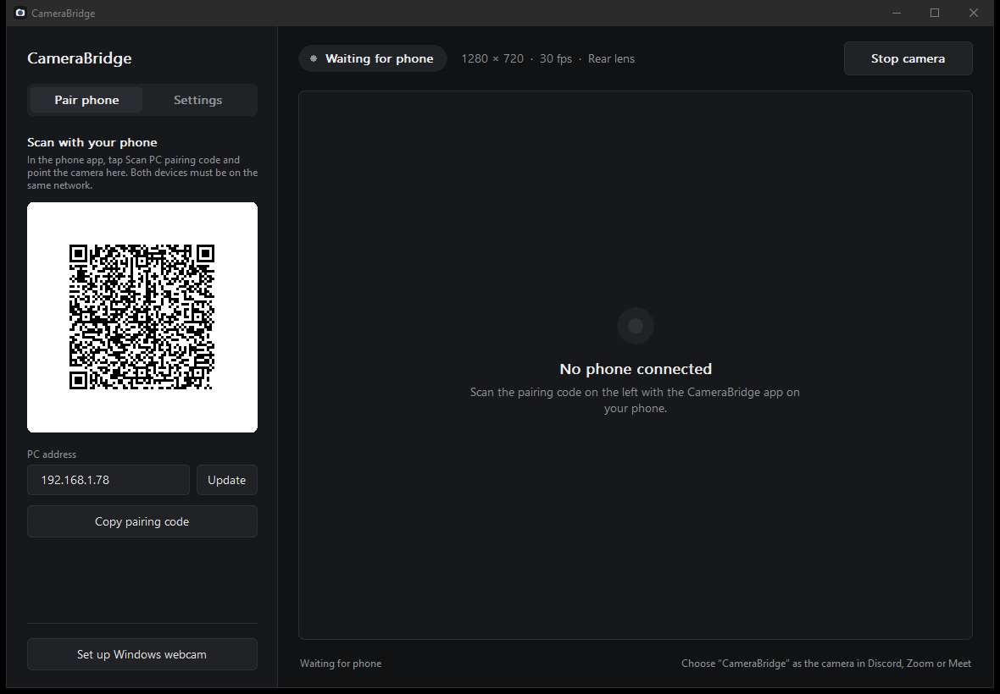
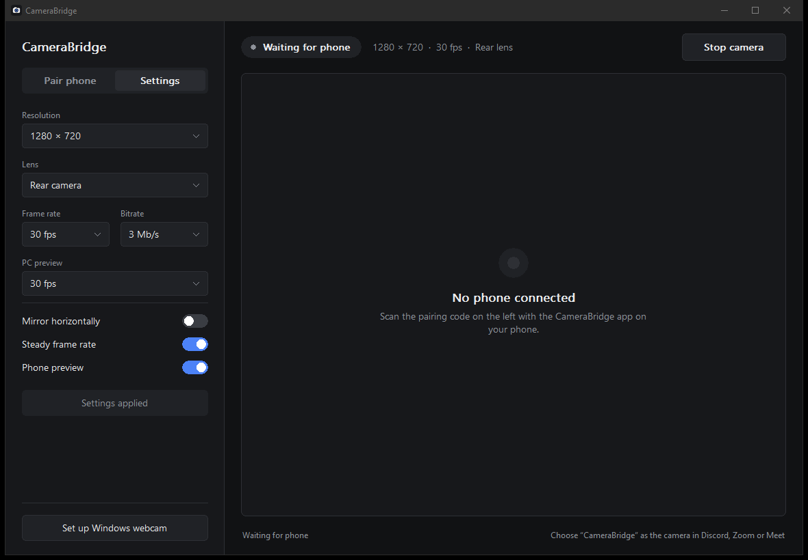

<p align="center"></p>

# CameraBridge

Use your Android phone as a Windows webcam over Wi-Fi. Pair by scanning a QR
code, then select **CameraBridge** in Discord, Zoom, or another webcam app.

The GitHub repository is named DroidCam; the apps are named CameraBridge.
This project is independent of the commercial DroidCam product.

## Screenshots

### Pair your phone



### Adjust the camera



These are actual Windows app captures from a disposable demo profile. The QR
code does not contain the installed app's pairing credentials. Android uses a
matching dark interface with a camera preview, status chip, and side controls;
an Android screenshot is not included because no test device was available.

## Features

- Streams H.264 video over the local network with TLS and certificate pinning.
- Provides a Windows virtual webcam without requiring OBS or a Unity runtime.
- Supports rear/front cameras, 360p, 540p, and 720p, with 15–30 fps and 1–8 Mb/s bitrate.
- Lets the PC start and stop capture, switch cameras, and control the phone preview.
- Keeps streaming while you switch phone apps or lock the screen.
- Stops sharing when you swipe the phone app away from recent apps.
- Uses native Windows controls and a Rust streaming core. No browser or Python runtime ships in the Windows app.

Video is streamed, not saved as a recording. Audio is not transmitted; select
your PC microphone separately.

## Requirements

| Component | Requirement |
| --- | --- |
| PC | 64-bit Windows; administrator access for initial webcam/firewall setup |
| Phone | Android 8.0 or later, ARM64, camera permission |
| Network | Both devices on the same trusted local network; no client isolation |

## Get started

Build the apps using the instructions below. Build outputs are local artifacts,
not files tracked in this repository.

1. Extract the Windows package, or open `dist/CameraBridge-Rust/CameraBridge.exe`
   after building. Keep its `third_party` folder beside the executable.
2. Click **Set up Windows webcam**. Approve elevation to register the webcam
   and configure the firewall. Restart your video app after the first setup.
3. Install `dist/CameraBridge-Android.apk` on the phone and allow camera access.
4. Open **Pair phone** on the PC. On the phone, tap **Scan PC pairing code**
   and scan the displayed QR code. Pasting the pairing text is also supported.
5. Select **CameraBridge** as the camera in your video app. Use **Start camera**
   or **Stop camera** on the PC to control capture.

If the PC shows the wrong network address, enter its LAN IPv4 address and click
**Update** before pairing. Pairing codes grant camera access: keep them private.

## Background behavior

Home, switching apps, and screen lock leave sharing active. The Android
foreground notification provides a **Stop sharing** action. On phones with
aggressive battery management, allow unrestricted background activity.

Swiping CameraBridge away from recent apps stops capture, closes the PC
connection, removes the notification, and releases its wake/Wi-Fi locks. Reopen
the app and enable PC control to share again. **Stop camera** only pauses capture;
**Stop sharing** also disables remote camera access.

## Build from source

Install Rust stable **1.99+**, Visual Studio C++ build tools and the Windows SDK,
JDK **17+**, and Python **3.12+**. Run from the repository root on Windows:

```powershell
powershell -NoProfile -File scripts/build_windows.ps1
python scripts/build_android.py
python scripts/package_release.py
```

The Android builder downloads and caches Google's SDK/NDK and ZXing under
`.tools`. The first build needs internet access. Keep the generated
`.tools/camerabridge-local.jks` private and backed up: the same key is required
to install future APKs over your existing installation.

Outputs:

- `dist/CameraBridge-Windows-Rust.zip`
- `dist/CameraBridge-Android.apk`
- `dist/SHA256SUMS-Rust.txt`

The Windows package includes setup scripts, third-party notices, and a
`VALIDATION.json` report from its self-test. The APK targets ARM64 phones only.

### Checks

```powershell
cargo test --locked --workspace
cargo clippy --workspace --all-targets -- -D warnings
powershell -NoProfile -File scripts/check_jni.ps1
powershell -NoProfile -File scripts/check_rust_ui.ps1
```

The tests cover packet bounds, congestion recovery, rotation, FPS policy, TLS,
decoding, virtual webcam row order, settings persistence, and JNI lifecycle
handling. Phone capture, prolonged screen lock, launcher icon appearance, and
video-app compatibility still need real-device verification.

### Icon and documentation assets

The shared camera mark is in `assets/icon.png` and `assets/icon.ico`. Windows
embeds the ICO into the executable; Android includes density-specific launcher
images, an adaptive icon, and a notification silhouette.

To regenerate the icons, install Pillow in your development environment and run
`python scripts/generate_icons.py`. To refresh the Windows screenshots, close
the receiver and run `powershell -NoProfile -File scripts/capture_screenshots.ps1`.
That script creates and removes an isolated pairing profile.

## Troubleshooting and limitations

- **Phone cannot connect:** check LAN access, the displayed IPv4 address,
  Windows Firewall, VPN routing, and router client isolation.
- **No webcam in your video app:** run webcam setup, then restart the video app.
- **Phone stops when locked:** enable unrestricted battery/background access.
- **High PC CPU usage:** the receiver currently uses OpenH264 software decoding.
  Reduce resolution or FPS; disabling PC preview also reduces preview work.
- **No audio or saved video:** this is a live video webcam bridge.

See [architecture and implementation notes](docs/ARCHITECTURE.md),
[legacy Python receiver documentation](docs/LEGACY_README.md), and
[third-party components and licenses](THIRD_PARTY.md).
